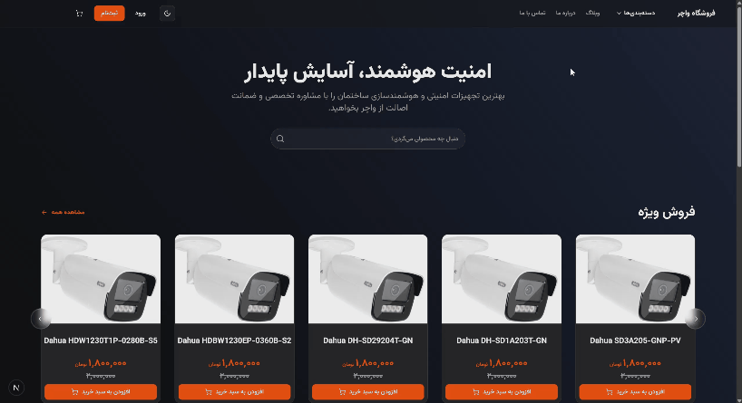
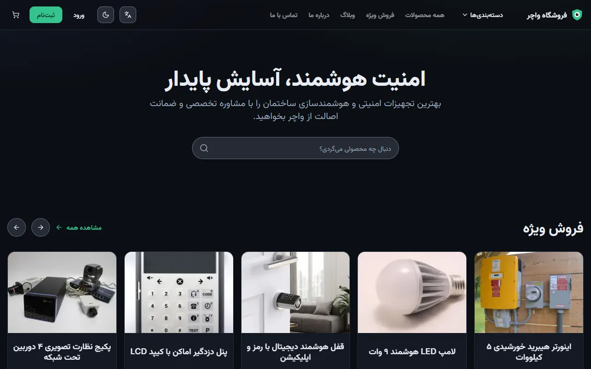
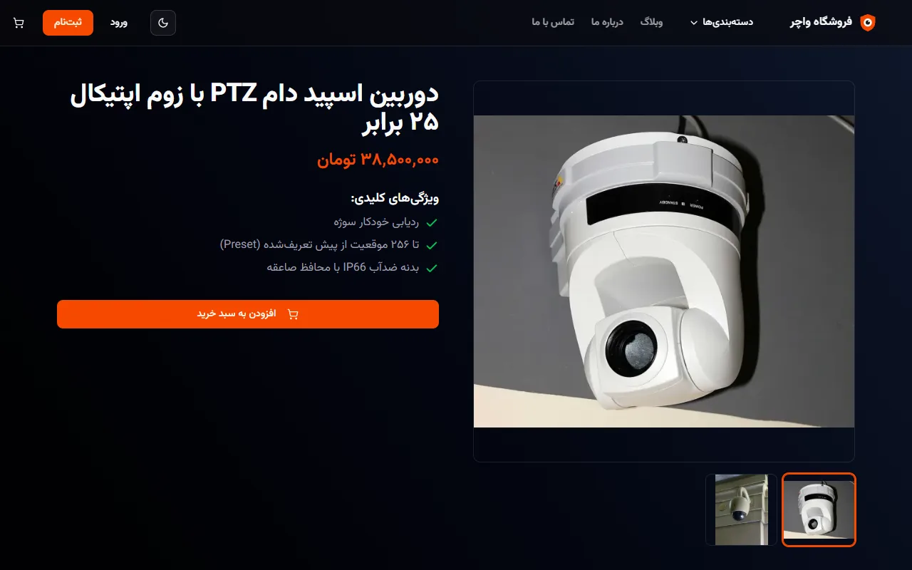
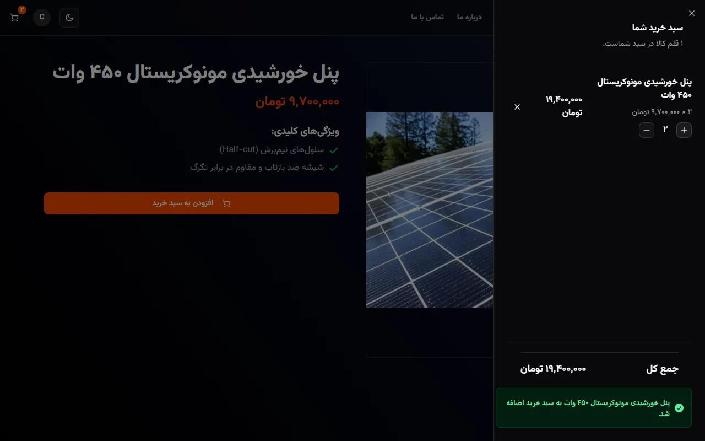
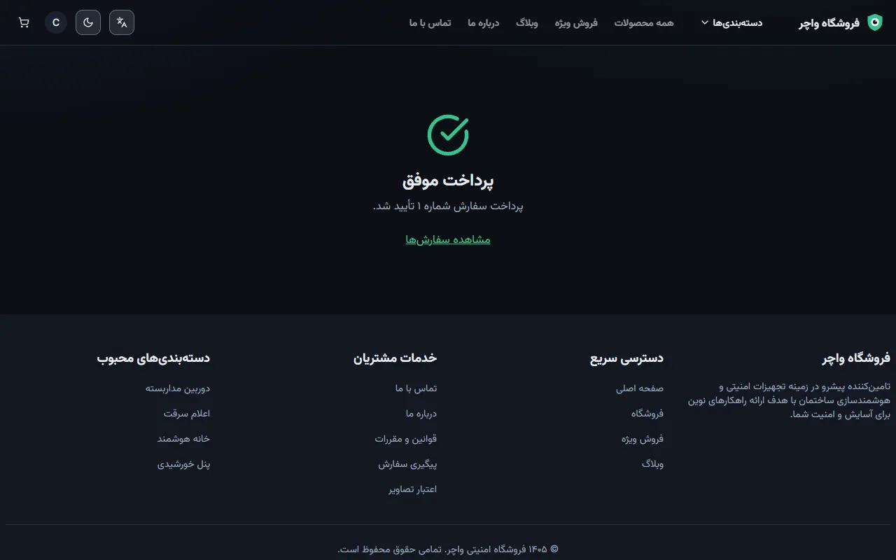
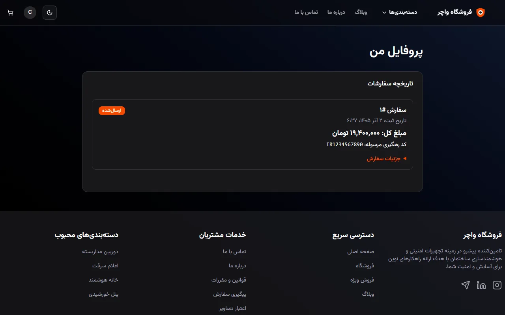
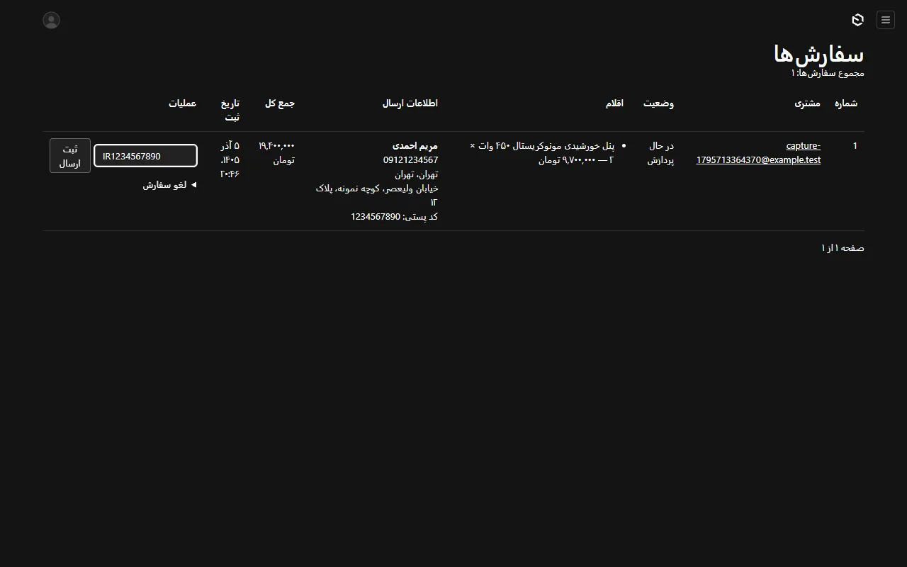
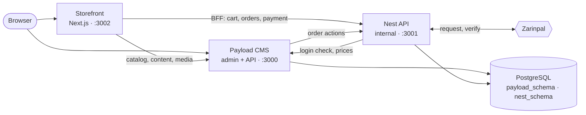

# Watcher Store

[](https://github.com/Soheyl-Khajian/Watcher-Store/actions/workflows/ci.yml)
[](https://github.com/Soheyl-Khajian/Watcher-Store/actions/workflows/codeql.yml)
[](LICENSE)

A Persian (right-to-left) online shop for security, CCTV, smart-home and
solar equipment: a Next.js storefront, Payload CMS for the catalog and
content, and a NestJS API for carts, orders and payments through the
Zarinpal gateway, in a pnpm workspace on one PostgreSQL database.



- **Live demo:** _link to be added after deployment_
- **Demo accounts:** _to be added with the live demo_ (a local stack gets its own, see [Production stack](#production-stack))

> This is a portfolio project. The products, prices and contact details are
> fictional; payments run against Zarinpal's sandbox or a local mock.

---

## Contents

- [Features](#features)
- [Screenshots](#screenshots)
- [Architecture](#architecture)
- [Security and engineering decisions](#security-and-engineering-decisions)
- [Running it locally](#running-it-locally)
- [Production stack](#production-stack)
- [Configuration](#configuration)
- [Testing](#testing)
- [Project structure](#project-structure)
- [License and credits](#license-and-credits)

---

## Features

**Storefront** (Next.js 15, React 19, Tailwind CSS 4)

- Category tree, product pages with gallery, specifications and sale
  prices, product search, blog and CMS pages; all in Persian, right to left,
  with Persian digits.
- Cart with quantity controls checked against stock; checkout with an
  Iranian address and phone validation; payment through Zarinpal.
- Order history with details, tracking codes, cancel and pay-again for
  unpaid orders; a payment result page that reads the order's real status.
- SEO: per-page metadata and Open Graph images, product JSON-LD (price and
  availability), sitemap and robots.txt.
- Error and not-found pages that answer with the right status codes, and a
  readiness endpoint that checks the services behind it.

**Administration** (Payload CMS 3)

- Products, categories, posts, pages, media and the footer, with an admin
  panel in Persian or English.
- An Orders view with each order's items, shipping details and refund
  status, and the actions its status allows: ship with a tracking code,
  record delivery, cancel, mark refunded.
- Bulk price changes for a category and everything under it.
- Content edits appear on the storefront at once (tag revalidation).

**Commerce API** (NestJS 10, TypeORM)

- Carts, idempotent order placement, stock reserved at order time and
  released on cancellation or expiry.
- Zarinpal v4 payments, verified server to server; a reconciliation job
  for customers who pay and never come back; refunds flagged when money
  arrives for a cancelled order.
- Structured JSON logs with request ids, health and readiness checks,
  per-client rate limits.

---

## Screenshots

| Storefront                                                | Product                                                   |
| --------------------------------------------------------- | --------------------------------------------------------- |
|                 |           |
| **Cart**                                                  | **Payment result**                                        |
|                      |  |
| **Order history**                                         | **Admin: Orders view**                                    |
|  |      |

---

## Architecture



| App          | Path                   | Stack                                            | Role                                                          |
| ------------ | ---------------------- | ------------------------------------------------ | ------------------------------------------------------------- |
| Storefront   | `frontend/`            | Next.js 15, React 19, Tailwind 4, Zustand, Zod   | The shop, and the backend-for-frontend that holds the session |
| CMS          | `backend/payload-cms/` | Payload 3 on Next.js, Postgres adapter, Sharp    | Users and roles, catalog, stock, content, media, admin panel  |
| Commerce API | `backend/nest-api/`    | NestJS 10, TypeORM, Passport JWT, Pino, Terminus | Carts, orders, payments, background jobs                      |
| End-to-end   | `e2e/`                 | Playwright, mock Zarinpal                        | Tests the production stack in a browser                       |

Payload and Nest share one PostgreSQL database, each in its own schema
with its own database role. Payload owns users, products and stock; Nest
reads the few columns it needs (who a user is, product stock) and gets
prices through Payload's API.

**[docs/architecture.md](docs/architecture.md)** has the details: the
login flow, the payment sequence, and the order and payment state machines.

---

## Security and engineering decisions

- **No tokens in the browser.** The storefront's `/api` routes act as a
  backend-for-frontend: Nest's JWT lives in an httpOnly, Secure,
  SameSite=Lax cookie (`__Host-` prefixed over https), and mutating calls
  must come from the storefront's origin with a custom header (CSRF). The
  Nest API itself is not published.
- **Payments are verified, never trusted from the URL.** The gateway's
  redirect only says which payment to check; Nest verifies it with
  Zarinpal, server to server, including the amount, before an order is
  marked paid. Settling a payment twice changes nothing.
- **Stock reserved at order time.** Taking stock, creating the order and
  later releasing it all happen in transactions with row locks, so two
  customers cannot both buy the last unit, and a paid order can always be
  shipped. The expiry job uses `FOR UPDATE SKIP LOCKED`, so several API
  instances can run it at once.
- **Idempotent checkout.** Placing an order needs an `Idempotency-Key`; a
  retried request returns the same order instead of a second one.
- **One state machine.** Every order status change goes through one table
  of allowed transitions; the admin buttons only offer what it allows, and
  Nest refuses anything else with 409.
- **Least privilege in the database.** Each service connects as its own
  role, owning only its schema; in Payload's schema Nest may read a user's
  id, email and role and a product's id, status and stock, and update only
  the stock (and its timestamp), column by column (`deploy/postgres/`).
- **Content Security Policy with nonces.** Every storefront page gets a new
  nonce; only scripts carrying it run (`strict-dynamic`). Images come only
  from the shop itself; framing, plugins and other sites' scripts are
  refused. HSTS, nosniff, Referrer-Policy and Permissions-Policy on both
  apps.
- **Rate limits per real client.** Login, ordering and the API as a whole
  are limited per client address; the storefront forwards only an address
  its trusted proxies reported (`TRUSTED_PROXY_HOPS`), so clients cannot
  pick their own.
- **Hardened containers.** Non-root images without npm, read-only app
  files, per-service secrets in Compose, memory limits, capped logs; Trivy
  scans every image in CI, with Dependabot and CodeQL alongside.
- **Fail fast on bad configuration.** Every service validates its
  environment at startup and refuses placeholder secrets, default database
  passwords and half-configured features in production.
- **Content safety.** CMS links are rendered only with safe URL schemes;
  uploads accept raster images only (no SVG), up to 5 MB.

---

## Running it locally

The supported development setup is a **Dev Container** (VS Code or Cursor
with the Dev Containers extension, and Docker). You do not need Node,
pnpm or PostgreSQL on your machine.

1. Clone the repository and create the configuration:

   ```bash
   git clone https://github.com/Soheyl-Khajian/Watcher-Store.git
   cd Watcher-Store
   cp .env.example .env
   ```

   Set `PAYLOAD_SECRET` and `JWT_SECRET` to random values
   (`openssl rand -hex 32`), and `PAYMENT_GATEWAY=mock` so checkout works
   without a gateway account (every payment then succeeds at once). The
   rest works as it is for development.

2. Open the folder in the editor and run **Dev Containers: Reopen in
   Container**. The first start builds the container, starts PostgreSQL
   (host port 5433), installs the packages (`.devcontainer/bootstrap.sh`)
   and applies Payload's migrations (`.devcontainer/start.sh`). The three
   apps then start as VS Code tasks, one terminal each (or set
   `AUTOSTART_SERVERS=1` to have the container start them). Ports
   3000–3002 are forwarded.

3. Fill the store with the demo data, in a terminal inside the container:

   ```bash
   DEMO_ADMIN_EMAIL=admin@example.com DEMO_ADMIN_PASSWORD=change-me-please \
     pnpm --filter payload-cms seed:demo
   ```

   This creates the categories, 32 products with photos, blog posts, pages
   and the administrator. It is safe to run again.

| URL                         | What                                     |
| --------------------------- | ---------------------------------------- |
| http://localhost:3002       | Storefront                               |
| http://localhost:3000/admin | Payload admin (log in as the demo admin) |
| http://localhost:3001       | Nest API (`/health`, `/health/ready`)    |

To try Zarinpal's sandbox instead of the mock, set
`PAYMENT_GATEWAY=zarinpal` and a sandbox `ZARINPAL_MERCHANT_ID` (any UUID
works there).

Useful commands (repository root, inside the container):

| Command                                                | Purpose                                      |
| ------------------------------------------------------ | -------------------------------------------- |
| `pnpm start:all`                                       | Run the three apps (the container does this) |
| `pnpm start:payload` / `start:nest` / `start:frontend` | Run one app                                  |
| `pnpm lint` · `pnpm typecheck` · `pnpm format:check`   | Static checks                                |
| `pnpm build`                                           | Production builds of all apps                |
| `pnpm --filter payload-cms migrate`                    | Apply Payload migrations                     |
| `pnpm --filter payload-cms generate:migration`         | Create a Payload migration                   |
| `pnpm --filter nest-api migration:generate`            | Create a Nest migration                      |
| `pnpm --filter payload-cms seed:demo`                  | Demo data                                    |
| `pnpm --filter payload-cms seed:admin`                 | Create the administrator from `ADMIN_*`      |

---

## Production stack

`docker-compose.prod.yml` runs the whole shop: PostgreSQL, the database
role and migration jobs, Payload, Nest and the storefront, each from its
own non-root image. Only the storefront (3002) and Payload (3000) are
published, on `127.0.0.1`, for a reverse proxy with TLS in front.

```bash
cp .env.example .env
# Set strong values: PAYLOAD_SECRET, JWT_SECRET, POSTGRES_PASSWORD (and in
# DATABASE_URI), PAYLOAD_DB_PASSWORD, NEST_DB_PASSWORD; and your public URLs.
docker compose -f docker-compose.prod.yml up -d --build
```

Then create the administrator (or the whole demo store):

```bash
docker compose -f docker-compose.prod.yml exec \
  -e ALLOW_DEMO_SEED=true \
  -e DEMO_ADMIN_EMAIL=admin@example.com -e DEMO_ADMIN_PASSWORD=<password> \
  payload-cms ./node_modules/.bin/payload run src/seed-demo.ts
```

For a real deployment, put a reverse proxy in front (and set
`TRUSTED_PROXY_HOPS=1`), choose `PAYMENT_GATEWAY=zarinpal` with your
merchant id, and consider `S3_BUCKET` for media. Each service checks its
configuration at startup and names anything missing.

---

## Configuration

All settings live in one `.env` at the repository root;
[`.env.example`](.env.example) documents each one. The production Compose
file hands each service only the settings it uses.

| Setting                                                       | Used by         | Purpose                                                               |
| ------------------------------------------------------------- | --------------- | --------------------------------------------------------------------- |
| `POSTGRES_USER` / `POSTGRES_PASSWORD` / `POSTGRES_DB`         | database        | Superuser, used only by the database and its setup jobs in production |
| `PAYLOAD_DB_PASSWORD` / `NEST_DB_PASSWORD`                    | production      | Passwords of the services' own database roles                         |
| `PAYLOAD_SECRET`                                              | Payload         | Signs Payload sessions (32+ characters)                               |
| `DATABASE_URI` / `PAYLOAD_SCHEMA`                             | Payload         | Database connection and schema (development)                          |
| `PAYLOAD_PUBLIC_URL`                                          | Payload         | Where browsers reach the CMS; the only origin trusted for its cookie  |
| `JWT_SECRET` / `JWT_EXPIRES_IN`                               | Nest            | Signs storefront sessions, and their lifetime                         |
| `PAYMENT_GATEWAY`                                             | Nest            | `none`, `zarinpal` or `mock` (development only)                       |
| `ZARINPAL_MERCHANT_ID` / `ZARINPAL_BASE_URL`                  | Nest            | Zarinpal account and endpoint (sandbox by default)                    |
| `PAYMENT_CALLBACK_URL`                                        | Nest            | Where the gateway sends customers back (the storefront relays it)     |
| `PAYMENT_RECONCILE_AFTER_MINUTES` / `PENDING_ORDER_TTL_HOURS` | Nest            | When pending payments are re-checked and unpaid orders cancelled      |
| `RATE_LIMIT_*` / `TRUST_PROXY`                                | Nest            | Per-client limits, and which proxies may report the client address    |
| `NEXT_PUBLIC_PAYLOAD_URL` / `NEXT_PUBLIC_FRONTEND_URL`        | Storefront      | Public addresses, built into the browser bundle                       |
| `PAYLOAD_INTERNAL_URL` / `NEST_INTERNAL_URL`                  | Storefront, CMS | Server-to-server addresses                                            |
| `TRUSTED_PROXY_HOPS`                                          | Storefront      | Reverse proxies in front of the storefront (0 or 1)                   |
| `REVALIDATE_SECRET` / `STOREFRONT_INTERNAL_URL`               | CMS, Storefront | Instant cache refresh after content edits                             |
| `S3_*`                                                        | Payload         | Media in an S3-compatible bucket instead of a volume                  |
| `ADMIN_*` / `DEMO_*` / `ALLOW_DEMO_SEED`                      | seed scripts    | The administrator, and the demo data                                  |
| `LOG_LEVEL`                                                   | Nest            | Log verbosity (JSON in production)                                    |

---

## Testing

| Suite                  | Command                        | What it covers                                                                                                     |
| ---------------------- | ------------------------------ | ------------------------------------------------------------------------------------------------------------------ |
| Unit and integration   | `pnpm test`                    | Storefront (Vitest), Payload against a real PostgreSQL (Vitest), Nest units (Jest)                                 |
| API end-to-end         | `pnpm test:e2e`                | Nest against PostgreSQL with stub Payload and Zarinpal servers: auth, carts, orders, payments, concurrency, limits |
| Browser end-to-end     | `pnpm test:stack`              | The production stack in a browser: a whole purchase and the admin shipping it ([e2e/README.md](e2e/README.md))     |
| Production smoke check | `node scripts/smoke-check.mjs` | Every service answers and works with the others                                                                    |

The integration suites need a PostgreSQL where they may create databases:
set `TEST_DATABASE_URL` (the Dev Container's database works).

**CI** (`.github/workflows/`) runs on every push and pull request:
formatting, lint, typecheck and builds; the unit, integration and API
end-to-end tests against PostgreSQL; the production images built with
Buildx, smoke-tested, tested in a browser with Playwright and scanned with
Trivy; and CodeQL. Dependabot keeps dependencies, base images and actions
up to date.

---

## Project structure

```
Watcher-Store/
├── frontend/                  # Next.js storefront and its /api BFF routes
├── backend/
│   ├── payload-cms/           # Payload CMS: collections, admin views, seed data
│   └── nest-api/              # NestJS API: cart, orders, payment, jobs
├── e2e/                       # Playwright tests and the mock Zarinpal gateway
├── deploy/postgres/           # Database roles and grants for production
├── docs/architecture.md       # Flows and state machines
├── scripts/                   # Smoke check, type sync
├── .devcontainer/             # Development container
├── docker-compose.prod.yml    # Production stack
└── .github/                   # CI, CodeQL, Dependabot
```

---

## License and credits

The code is released under the [MIT License](LICENSE). The product and
blog photos in the demo data are openly licensed photos from Wikimedia
Commons; each one's author and license is listed in
[`credits.json`](backend/payload-cms/src/seed/demo-images/credits.json) and
on the store's image-credits page. They are not covered by the MIT
License, and the products shown are not their makers' products. The
"Watcher Store" name and logo are not covered either.
