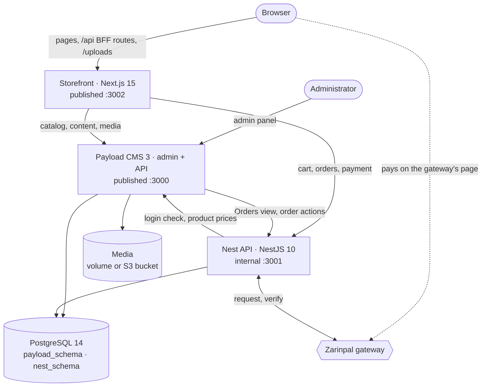
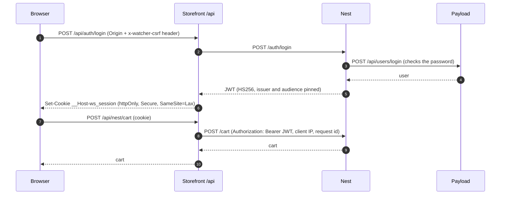
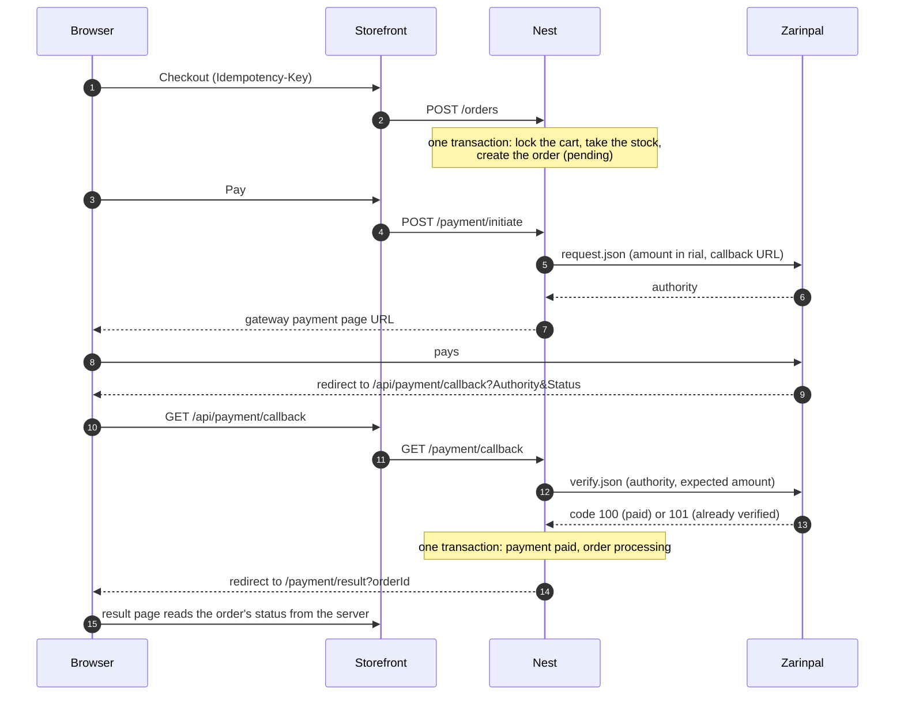
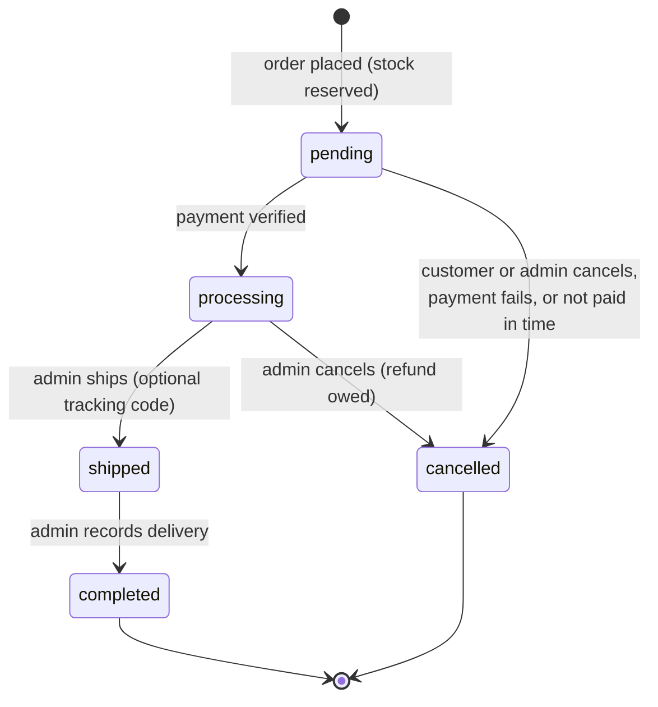
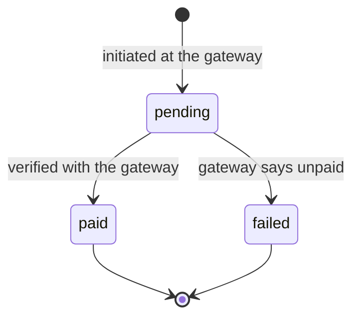

# Architecture

How the three applications divide the work, how a customer is
authenticated, and how an order moves from the cart to the customer's door.

## Services

The browser also reads product details from Payload's API for the cart
and checkout, and Payload tells the storefront when content changes (see
[Caching](#caching-and-content-updates)).

| Service    | Owns                                                                         | Database role                                                                                                              |
| ---------- | ---------------------------------------------------------------------------- | -------------------------------------------------------------------------------------------------------------------------- |
| Payload    | Users and roles, catalog (categories, products, stock), posts, pages, media  | `payload_app`, owner of `payload_schema`                                                                                   |
| Nest       | Carts, orders, payments, order expiry and payment reconciliation jobs        | `nest_app`, owner of `nest_schema`; reads `users (id, email, role)`, reads and updates `products (stock)` column by column |
| Storefront | No data of its own: renders Payload content and fronts Nest for the customer | none                                                                                                                       |

Migrations run as one-off jobs before the services start (`payload-migrate`,
`nest-migrate`), after `db-roles` has created the roles and schemas
(`deploy/postgres/`).

## Logging in (backend-for-frontend)

The browser never holds a token. The storefront's own `/api` routes keep
Nest's JWT in an httpOnly cookie and call Nest on the customer's behalf.

Mutating `/api` calls must come from the storefront's own origin and carry
the `x-watcher-csrf` header. The `/api/nest/*` proxy forwards only an
allow-list of paths and methods.

## Paying

Stock is reserved when the order is placed, so a paid order can always be
fulfilled. The gateway's redirect only says where to look: Nest verifies
every payment with the gateway, server to server, before the order changes.

If the customer pays and closes the browser before coming back, the
reconciliation job asks the gateway about payments still pending after
`PAYMENT_RECONCILE_AFTER_MINUTES` and settles them the same way. A replayed
callback changes nothing: the payment is no longer pending.

## Order states

Every status change goes through one state machine
(`backend/nest-api/src/orders/order-state.ts`), inside a transaction that
locks the order row.

- Cancelling puts the reserved stock back.
- Unpaid orders are cancelled after `PENDING_ORDER_TTL_HOURS` by the expiry
  job, which takes each order with `FOR UPDATE SKIP LOCKED`, so several API
  instances can run it at once.
- A refund is tracked separately (`none`, `required`, `refunded`): an order
  cancelled after payment, or a payment that arrives for an order already
  cancelled, is marked `required` and shown in the admin's Orders view until
  an administrator marks it refunded.

## Payments

Amounts are kept in toman and sent to the gateway in rial (× 10); the
verification must report the same amount.

## Caching and content updates

Storefront pages render per request (each carries a new CSP nonce), on top
of cached data: products for 60 seconds, everything else for an hour, each
fetch tagged by collection. When content changes in Payload, its hooks call
the storefront's `POST /api/revalidate` (with `REVALIDATE_SECRET`) and the
affected tags are dropped at once.

## Media

Payload stores uploads on a volume or, with `S3_BUCKET` set, in an
S3-compatible bucket; either way they are served through Payload with its
access rules. The storefront shows them from its own `/uploads/<file>`,
fetched from Payload's internal address, so `next/image` can optimize them
and the CSP allows images only from the shop itself.
